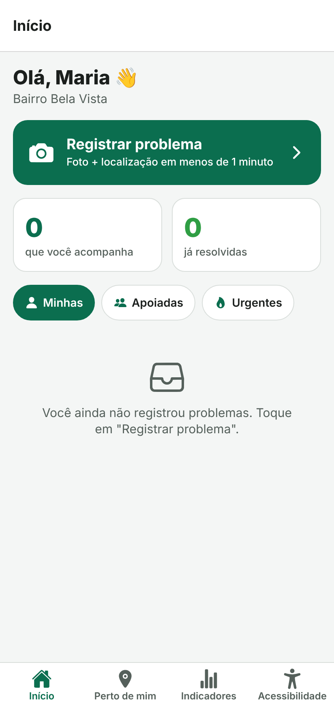
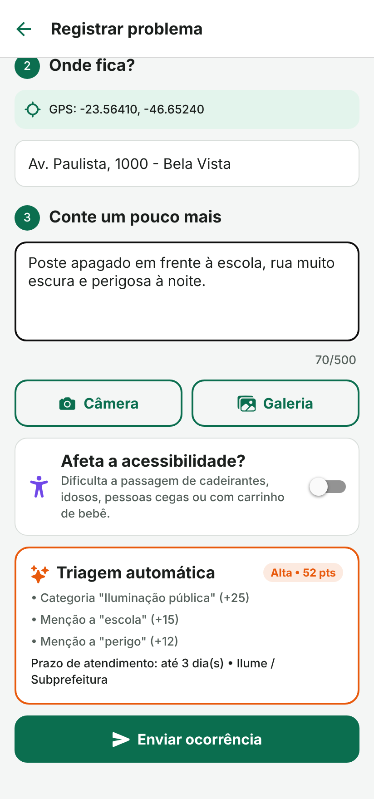
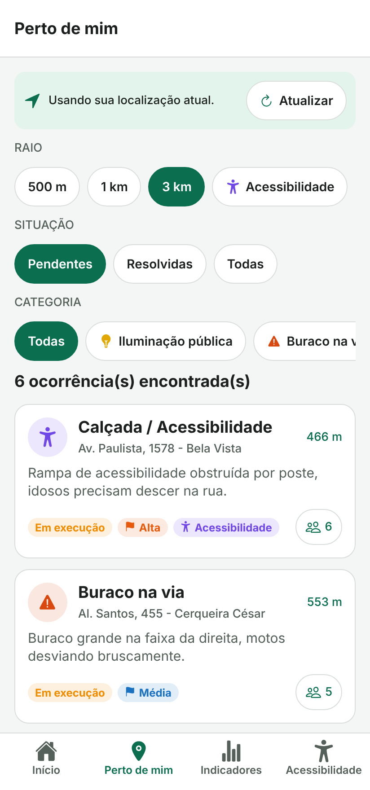
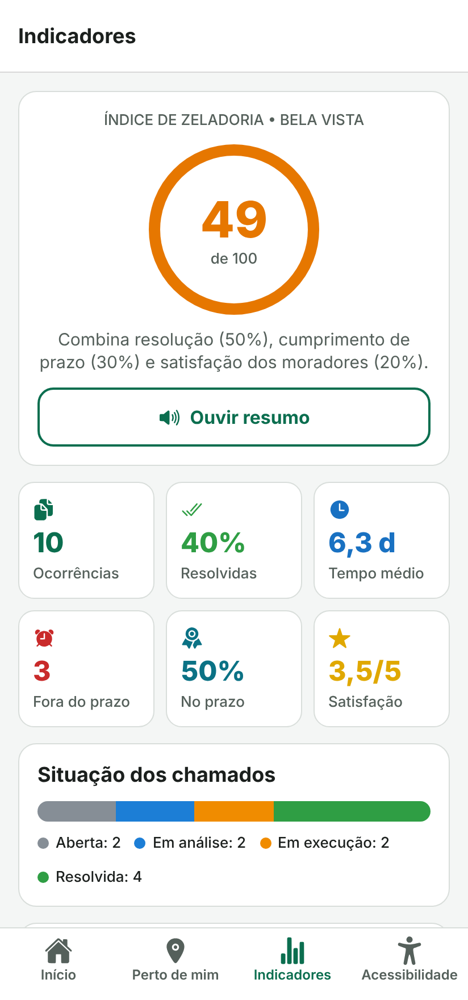
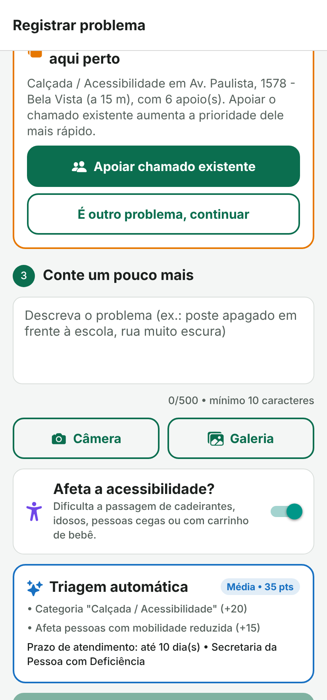
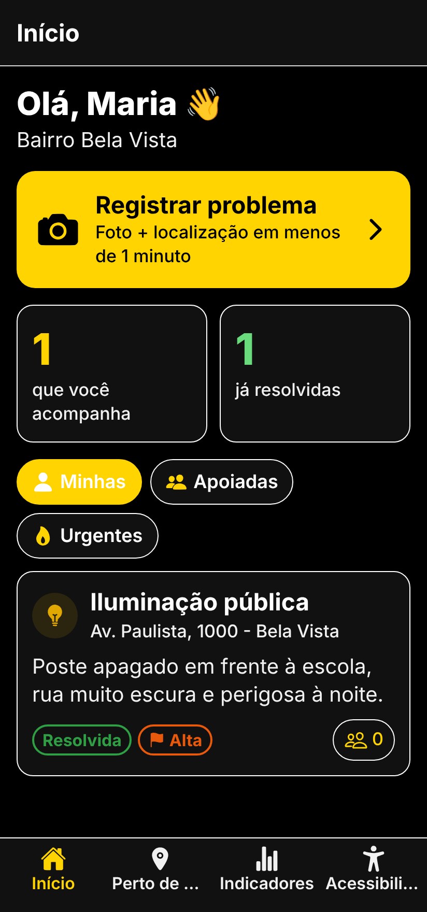

# 🏘️ BairroAtivo — zeladoria urbana colaborativa e acessível

**Global Solution 2 · 2026 — CitizenTech: Tecnologia centrada no cidadão** · Turma 3SIOA

Aplicativo em **React Native (Expo + TypeScript)** em que moradores registram problemas do bairro (iluminação, buracos, calçadas, alagamentos, vazamentos…) em menos de 1 minuto, com **triagem automática de prioridade**, **detecção de duplicidade com apoio comunitário**, **acompanhamento transparente do protocolo**, **indicadores do bairro** e **acessibilidade nativa** para idosos e pessoas com deficiência. Back-end de dados em **Oracle + PL/SQL**.

<p align="center">
  
  
  
  
</p>
<p align="center">
  
  
  
  
</p>

## Funcionalidades
1. **Registro inteligente** — foto, GPS + endereço automático, triagem explicada, prazo e órgão responsável.
2. **Anti-duplicidade + "Também me afeta"** — chamados repetidos a ≤150 m viram apoio e elevam a prioridade.
3. **Perto de mim** — ocorrências por distância com filtros de raio, situação, categoria e acessibilidade.
4. **Acompanhamento** — protocolo, linha do tempo, alerta de atraso e avaliação do atendimento.
5. **Indicadores do bairro** — Índice de Zeladoria, resolução, prazo, tempo médio, satisfação.
6. **Central de acessibilidade** — letras grandes, alto contraste e leitura em voz alta.

**ODS:** 11 (Cidades sustentáveis) · 10 (Redução das desigualdades) · 6 (Água) · 16 (Instituições eficazes)

## Executar
```bash
cd app
npm install
npx expo start      # escaneie o QR Code com o Expo Go (ou tecle "w" para web)
```
Banco: `database/00_instalar_tudo.sql` (instruções completas no [README.txt](README.txt)).

## Documentação
- [README.txt](README.txt) — instruções de execução e justificativas técnicas
- [Documentação técnica](docs/DOCUMENTACAO_TECNICA.md) — funções, classes, gerenciamento de memória, tecnologias, ODS
- [Modelo de dados (MER + DER)](docs/modelo/MODELO_DE_DADOS.md)
- [Scripts Oracle / PL/SQL](database/) · [evidência de execução](database/evidencia_execucao_oracle23ai.txt)
- [Entregáveis e roteiros dos vídeos](entregaveis/)
