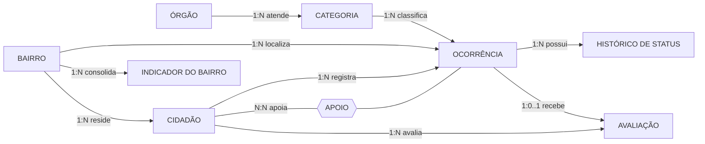
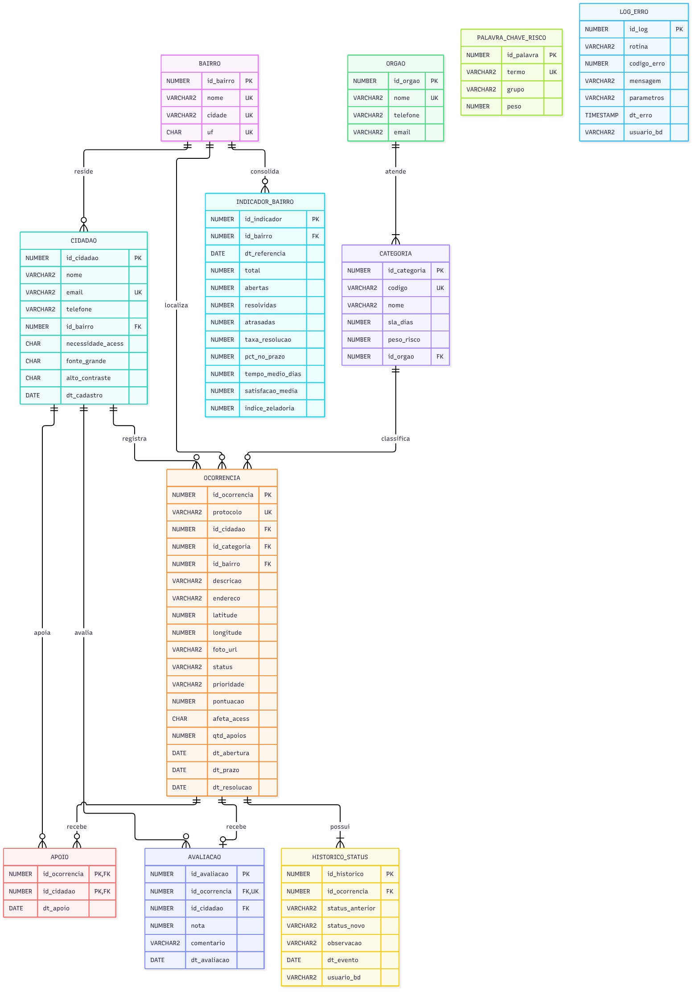

# Modelo de Dados — BairroAtivo

Este documento traz o **MER** (Modelo Entidade-Relacionamento, nível conceitual) e o **DER** (Diagrama Entidade-Relacionamento, nível lógico/físico) da solução. O modelo foi implementado em **Oracle Database** (scripts em [`/database`](../../database)).

---

## 1. MER — Modelo conceitual

### 1.1 Entidades

| Entidade | Descrição | Atributos principais |
|---|---|---|
| **BAIRRO** | Área geográfica atendida pela plataforma | nome, cidade, UF |
| **CIDADÃO** | Morador que usa o app | nome, e-mail, telefone, necessidade de acessibilidade, preferências de interface |
| **ÓRGÃO** | Órgão público responsável pelo atendimento | nome, telefone, e-mail |
| **CATEGORIA** | Tipo de problema urbano | código, nome, **SLA (prazo em dias)**, **peso de risco** |
| **PALAVRA-CHAVE DE RISCO** | Base de conhecimento da triagem automática | termo, grupo, peso |
| **OCORRÊNCIA** | Problema registrado pelo cidadão (entidade central) | protocolo, descrição, endereço, latitude/longitude, foto, status, prioridade, pontuação, afeta acessibilidade, quantidade de apoios, datas de abertura/prazo/resolução |
| **APOIO** | Associativa: cidadão que declara "também me afeta" | data do apoio |
| **HISTÓRICO DE STATUS** | Entidade fraca: linha do tempo do atendimento | status anterior, status novo, observação, data |
| **AVALIAÇÃO** | Nota do cidadão após a resolução | nota (1–5), comentário, data |
| **INDICADOR DO BAIRRO** | Fotografia diária dos indicadores | totais, taxa de resolução, % no prazo, tempo médio, satisfação, índice de zeladoria |
| **LOG DE ERRO** | Auditoria técnica das rotinas PL/SQL | rotina, código, mensagem, parâmetros |

### 1.2 Relacionamentos e cardinalidades

| Relacionamento | Entidades | Cardinalidade | Regra de negócio |
|---|---|---|---|
| **reside** | BAIRRO — CIDADÃO | 1 : N | Todo cidadão pertence a um bairro; um bairro tem 0..N cidadãos |
| **localiza** | BAIRRO — OCORRÊNCIA | 1 : N | Toda ocorrência pertence a um bairro |
| **consolida** | BAIRRO — INDICADOR_BAIRRO | 1 : N | Um registro de indicadores por bairro por dia |
| **atende** | ÓRGÃO — CATEGORIA | 1 : N | Cada categoria é encaminhada a um único órgão |
| **classifica** | CATEGORIA — OCORRÊNCIA | 1 : N | Toda ocorrência tem exatamente uma categoria (define SLA e peso) |
| **registra** | CIDADÃO — OCORRÊNCIA | 1 : N | Cada ocorrência tem um autor |
| **apoia** | CIDADÃO — OCORRÊNCIA (via APOIO) | N : N | Vários cidadãos podem ser afetados pela mesma ocorrência; cada um apoia uma vez (PK composta) |
| **possui** | OCORRÊNCIA — HISTÓRICO_STATUS | 1 : N (1..N) | Toda ocorrência tem pelo menos o evento "ABERTA" (gerado por trigger) |
| **recebe** | OCORRÊNCIA — AVALIAÇÃO | 1 : 0..1 | Só ocorrências resolvidas podem ser avaliadas, uma única vez (UK) |
| **avalia** | CIDADÃO — AVALIAÇÃO | 1 : N | Somente autor ou apoiador pode avaliar |

### 1.3 Diagrama conceitual

---

## 2. DER — Modelo lógico/físico

Arquivo-fonte do diagrama (Mermaid): [`DER.mmd`](DER.mmd) · versão vetorial: [`DER.svg`](DER.svg)

### 2.1 Restrições de integridade implementadas

| Tabela | Restrições |
|---|---|
| CIDADAO | `UK(email)`, `CHECK` formato de e-mail (REGEXP), flags `S/N` |
| CATEGORIA | `UK(codigo)`, `CHECK sla_dias 1..90`, `CHECK peso_risco 0..40` |
| OCORRENCIA | `UK(protocolo)`, `CHECK status IN (...)`, `CHECK prioridade IN (...)`, `CHECK pontuacao 0..100`, `CHECK` latitude/longitude, `CHECK dt_resolucao >= dt_abertura` |
| APOIO | `PK(id_ocorrencia, id_cidadao)` — impede apoio duplicado |
| AVALIACAO | `UK(id_ocorrencia)` — relação 1:1, `CHECK nota 1..5` |
| INDICADOR_BAIRRO | `UK(id_bairro, dt_referencia)` — um snapshot por dia |
| PALAVRA_CHAVE_RISCO | `CHECK termo = UPPER(termo)` |

### 2.2 Índices

`ix_ocorr_status_bairro (id_bairro, status)`, `ix_ocorr_categoria (id_categoria, status)`, `ix_ocorr_geo (latitude, longitude)` (pré-filtro geográfico da anti-duplicidade), `ix_ocorr_prazo (dt_prazo)` (rotina de atrasos), `ix_hist_ocorrencia`, além de índices em todas as FKs.

### 2.3 Normalização

O modelo está na **3ª Forma Normal**: atributos atômicos (1FN); tabela associativa APOIO com chave composta sem dependências parciais (2FN); dados do órgão e SLA ficam em ORGAO/CATEGORIA e não são repetidos na OCORRENCIA (3FN). As colunas `qtd_apoios`, `pontuacao` e `prioridade` são **desnormalizações controladas** (mantidas por triggers) para que as listas do app sejam lidas sem agregações a cada consulta.

---

## 3. Mapeamento App ⇄ Banco

| App (TypeScript) | Banco (Oracle) |
|---|---|
| `types/Ocorrencia` | `OCORRENCIA` |
| `Ocorrencia.historico[]` | `HISTORICO_STATUS` |
| `Ocorrencia.apoios / apoiadoPorMim` | `OCORRENCIA.qtd_apoios` / `APOIO` |
| `Ocorrencia.avaliacao` | `AVALIACAO.nota` |
| `constants/CATEGORIAS` (slaDias, pesoRisco, orgao) | `CATEGORIA` + `ORGAO` |
| `services/triagem.ts → calcularTriagem()` | `pkg_bairro_ativo.fn_calcular_pontuacao` + `PALAVRA_CHAVE_RISCO` |
| `services/triagem.ts → encontrarDuplicada()` | `pkg_bairro_ativo.prc_registrar_ocorrencia` (cursor `c_duplicadas`) |
| `services/geo.ts → distanciaKm()` | `pkg_bairro_ativo.fn_distancia_km` |
| `services/indicadores.ts → calcularIndicadores()` | `pkg_bairro_ativo.prc_gerar_indicadores` + `INDICADOR_BAIRRO` |
| `types/Perfil` | `CIDADAO` |
